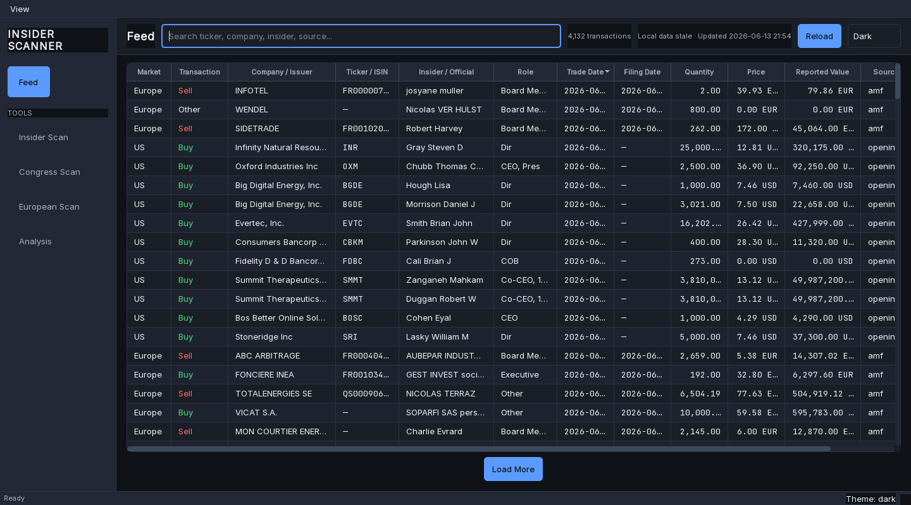
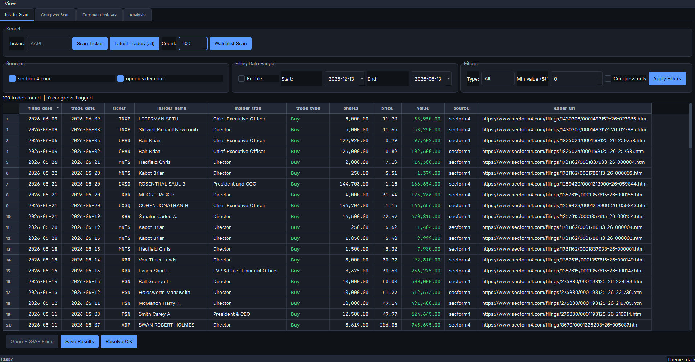
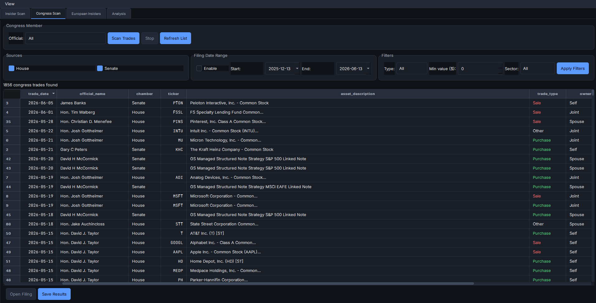
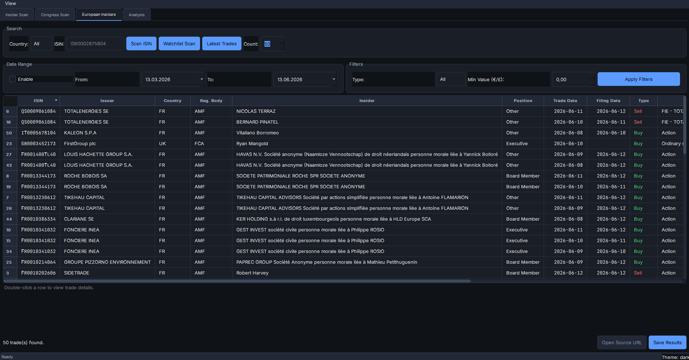
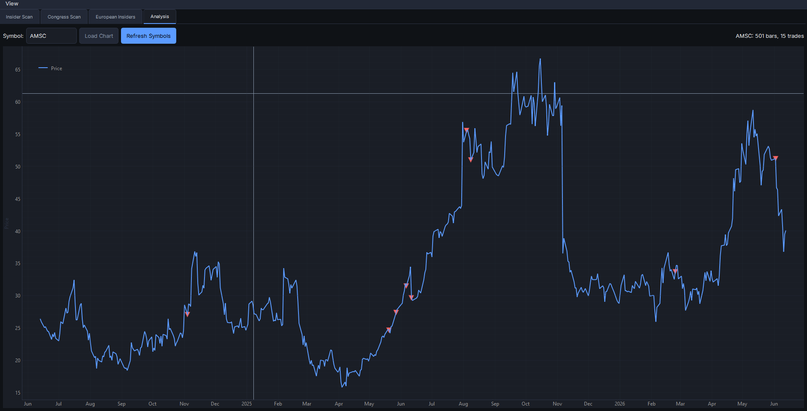

# Insider Scanner

[](https://pypi.org/project/insider-scanner/)
[](https://github.com/Czarnak/insider-scanner/actions/workflows/ci.yml)
[](https://pypi.org/project/insider-scanner/)
[](https://pepy.tech/project/insider-scanner)

Scan insider trades from **secform4.com**, **openinsider.com**, **SEC EDGAR**, and European regulators (FCA, BaFin, AMF, AFM). Includes congressional financial disclosure scanning (House and Senate), multi-source deduplication, committee-based sector filtering, and a desktop GUI with EDGAR filing links plus a European scan workspace.

## Install

Install the base package for the command-line interface:

```bash
pip install insider-scanner
insider-scanner-cli --help
```

Install the optional GUI dependencies for the desktop application:

```bash
pip install "insider-scanner[gui]"
insider-scanner
```

## Run

```bash
insider-scanner-cli --help # command-line interface
insider-scanner-cli --version # installed package version
insider-scanner            # desktop GUI (requires the gui extra)
```

## Development Setup

```bash
git clone https://github.com/Czarnak/insider-scanner.git
cd insider-scanner
pip install -e ".[gui,dev]"
```

### Requirements

Python 3.11.5+. Core dependencies include `curl-cffi`, `requests`, `beautifulsoup4`,
`lxml`, `pandas`, `pdfplumber`, `platformdirs`, and SQLAlchemy. Explicit
`cryptography` and `numpy` bounds preserve the supported transitive dependency
ranges for PDF parsing, pandas and the optional GUI.
The `gui` extra adds `PySide6` and `pyqtgraph`. The `maintainer` extra installs
PyYAML for `scripts/update_congress.py`; YAML is also included in `dev` for tests.

Release tags must match the version in `pyproject.toml` (for example, `v2.0.0`).
The package and `--version` read installed distribution metadata. Releases run
the same offline tests, coverage, lint, type and dependency checks as CI before
building artifacts, then verify base and GUI wheel/sdist installations. TestPyPI
verification installs dependencies from PyPI before replacing the candidate with
the exact TestPyPI version using `--no-deps`.

### Runtime data and cache directories

The application keeps its existing platform-specific data and cache locations
by default. To use a separate profile or another drive, set
`INSIDER_SCANNER_DATA_DIR` and/or `INSIDER_SCANNER_CACHE_DIR` before starting
the CLI or GUI. The data root contains SQLite, user state, seed files and
exports; the cache root contains downloaded filings and scraper caches.
Setting one override leaves the other root at its usual location. Existing
files are not moved automatically.

For example, in PowerShell:

```powershell
$env:INSIDER_SCANNER_DATA_DIR = 'D:\InsiderScanner\profile'
$env:INSIDER_SCANNER_CACHE_DIR = 'D:\InsiderScanner\cache'
insider-scanner
```

Tests always replace these overrides with a disposable profile before
application modules are collected, so they do not use your normal profile.

---

## Usage

### GUI

```bash
insider-scanner
# or
python -m insider_scanner.main
```

The GUI opens on a unified, read-only **Feed** built from transactions already
stored in the local SQLite database. Left navigation keeps the acquisition and
analysis workflows available under **Tools**.

#### Unified Feed

- Combines US corporate, US Congress, and European transactions into one
  date-ordered timeline without copying or migrating persisted records.
- Searches ticker/ISIN, company or issuer, insider or official, role,
  transaction type, market, and source.
- Uses backend sorting and 200-row paging so large local datasets do not need
  to be loaded into memory.
- Shows local-data freshness, empty and error states, semantic transaction
  labels, and direct filing/source links.
- Refreshes the feed, selected company/insider pages and alerts after scans
  finish, including partial results.

Alerts follow local ingestion order, so late filings and backfilled trades can
match regardless of their trade date. Each check presents up to 200 matches per
rule and reports how many remain. **Mark all seen** acknowledges that presented
page; further pages and trades ingested since the check remain pending.

Existing alert timestamps remain readable. Their final second is checked again
once to avoid losing matches to older timestamp precision. The database upgrade
adds ingestion positions for existing records without changing transaction data.

Top-bar search keeps typing focus while suggestions are visible. Use Up/Down to
choose a company or insider, Enter to open it or filter the feed, and Escape to
dismiss suggestions. Company and insider pages show their latest 200 transactions;
summary counts describe those displayed rows. Selecting another entity clears the
previous history while the new one loads.

The investigation drawer shows the selected transaction immediately and loads
extra context after a brief selection pause. Reloading, sorting or filtering the
feed closes the previous drawer so its details and actions follow the current row.



#### Insider Scan tool

- Search a ticker and run both secform4.com and openinsider.com scrapers in one click.
- Fetch the latest trades (configurable count) and scan US companies from the named Watchlists page. Individual ticker failures are reported while successful results remain available.
- Toggle sources, specify a date range, trade type, minimum value, or Congress-only filter.
- View sortable tables that display filing/trade dates, highlight congressional filings, show EDGAR links, and let you export CSV/JSON.
- Cancel long-running scans and resolve any ticker to its SEC CIK + filing page.

CIK lookup runs in the background; changing the ticker discards the previous
lookup before it can update the details or open a browser. Background requests
across the GUI display only their latest results. Closing the window requests
cooperative cancellation and shows a stopping message while work drains, keeping
the window responsive. An active network call finishes under its existing timeout
before the application closes its database and HTTP sessions.



#### Congress Scan tool

- Pick a legislator (House/Senate dropdown) or the whole committee list, select sources (House/Senate), and preview results in a threaded worker with progress + cancel.
- Use filters such as trade type, sector, and minimum value, then double-click any row to open the original PDF/PTR.
- Save filtered results to CSV/JSON, with exports reflecting the current filters.



#### European Scan tool

- Choose All/UK/DE/FR/NL, type an ISIN, or scan the user data directory's `eu_watchlist.txt`.
- Enable optional date bounds, filter by trade type and minimum value, and watch the progress bar while each ISIN is processed.
- Results are sortable, show normalized positions/currency, provide detail text on double-click, and allow opening the regulator source URL.
- Save filtered results to CSV/JSON (filename reflects the ISIN + country) or clear filters to adjust the view.



#### Analysis tool

- Select a US ticker from the dropdown list and click "Load Chart".
- Visualizes the past 2 years of daily price history using an interactive line graph with crosshairs.
- Overlays insider trade markers directly on the price line: corporate trades and congressional disclosures are both shown.
- Hover over trade markers to view detailed tooltips including insider name, role, trade size, and total value.
- The chart supports standard panning and zooming via pyqtgraph.

Price requests reuse the application's database and lazily opened provider
session. The cache records successful fetched intervals separately for each
provider, including empty weekends, holidays and pre-listing ranges. Historical
bars from older versions remain stored and are verified by the selected provider
before they establish coverage. Provider changes never mix cached adjustment bases.

Today's bars and empty current ranges are reused for at most five minutes, then
checked again; an unfinished bar must also be fetched again after midnight UTC.
Refreshes compare an overlapping completed bar. A changed close or adjusted close
triggers an atomic refresh of that symbol's cached history. A failed, malformed or
truncated replacement keeps the previous history intact. Adjustment changes are
detected when a missing or unfinished interval is refreshed; a fully cached
historical request does not poll the provider for later corporate actions.

Yahoo session dates use the exchange timezone (or its supplied UTC offset).
Malformed rows are skipped individually and cannot establish complete coverage;
provider failures report sanitized categories and HTTP status without response
bodies or credentials. Live provider availability is separate from offline tests.



#### Appearance & themes

- A single semantic design-token system drives both **light** and **dark** themes (WCAG AA contrast).
- Switch from **View ▸ Theme** (System / Light / Dark); the
  choice is remembered between sessions, and **System** follows the OS color
  scheme.
- Native dialogs and controls, alert transaction colors and filter errors follow
  the selected theme immediately.
- Transaction colors are semantic and always paired with text/sign (green = purchase, red = sale, amber = flagged/congress); tickers, dates, and monetary values use a monospace face for tabular alignment.
- The UI bundles the open-source **Inter** (sans) and **JetBrains Mono** (monospace) fonts, falling back to system fonts (Segoe UI / Consolas) when unavailable.

### CLI

```bash
# Scan a specific ticker (defaults to the last six calendar months)
insider-scanner-cli scan AAPL
insider-scanner-cli scan AAPL --type Buy --min-value 1000000 --save

# Scan with date range
insider-scanner-cli scan AAPL --since 2025-01-01 --until 2025-06-30

# Fetch the interval again, bypassing stored coverage and HTTP caches
insider-scanner-cli scan AAPL --since 2025-01-01 --until 2025-06-30 --no-cache

# Fetch latest insider trades
insider-scanner-cli latest --count 50 --save
insider-scanner-cli latest --since 2025-06-01 --until 2025-06-30

# Resolve SEC CIK
insider-scanner-cli resolve-cik AAPL
insider-scanner-cli cik AAPL # compatibility alias

# Fetch daily prices (defaults to the previous 365 days through today)
insider-scanner-cli price AAPL --since 2026-01-01 --until 2026-01-31

# Compare locally stored SEC and scraper transactions without fetching data
insider-scanner-cli sec-compare --ticker AAPL --date 2026-01-07
insider-scanner-cli sec-compare --ticker AAPL --since 2026-01-01 --until 2026-01-31 --format json --output comparison.json

# Set diagnostic verbosity before the command
insider-scanner-cli --log-level DEBUG latest --count 50

# Initialize default Congress member list
insider-scanner-cli init-congress

# Restore the packaged Congress list, backing up the current file first
insider-scanner-cli init-congress --force

# Congress-only filter
insider-scanner-cli scan AAPL --congress-only

# Import legacy JSON exports into SQLite
insider-scanner-cli import-legacy ./old-exports
insider-scanner-cli import-legacy ./large.json --max-file-size-mib 100
```

For `scan` and `latest`, provide both `--since` and `--until` when setting a date
range. `price` accepts either bound independently: the end defaults to today and
the start to 365 days before the end. Reversed ranges are rejected. `latest
--count` must be positive; repeat `--source` to select `secform4`, `openinsider`
or `sec_edgar`. Both `scan --save` and `latest --save` print the exported path.
An unresolved `resolve-cik`/`cik` reports the ticker on stderr and exits `1`.

`sec-compare` reads persisted data only. Repeat `--ticker` and `--date`, or use
one inclusive `--since`/`--until` range. `--legacy-source` selects comparison
sources (default: `secform4` and `openinsider`); `--format` accepts `text`,
`markdown` or `json`, and `--output` writes the report to a file.

CLI results and final summaries go to stdout; progress and errors go to stderr.
Detailed diagnostics are written to `insider-scanner.log`, rotating at 5 MiB with five
backups. The directory is `INSIDER_SCANNER_LOG_DIR` when set, otherwise `logs`
inside an overridden `INSIDER_SCANNER_DATA_DIR`, or the platform's user log
directory. Error messages show the active file path. If the file cannot be
opened, diagnostics remain on stderr. `--log-level` accepts `DEBUG`, `INFO`,
`WARNING`, `ERROR` or `CRITICAL`, and overrides `INSIDER_SCANNER_LOG_LEVEL`
(default: `INFO`).

| Exit code | Meaning                                                                                                                                    |
| --------- | ------------------------------------------------------------------------------------------------------------------------------------------ |
| `0`       | Command completed; per-filing failures alone are nonfatal.                                                                                 |
| `1`       | Operational failure, including an unresolved CIK, invalid SEC configuration, blocked SEC access or an archive error.                       |
| `2`       | Invalid arguments or input.                                                                                                                |
| `3`       | SEC dates are incomplete, XML backfill skipped unreadable members, or a dataset import has failed filings or unavailable quarter postings. |
| `130`     | Interrupted by Ctrl+C.                                                                                                                     |

Congress searches resolve seed names and disclosure spellings through the member's
structured first/last name and stable member ID. A unique surname can be searched;
Congress flagging requires a first name or initial as well. Existing stored
disclosure names remain readable, including honorifics, middle names and suffixes.

The authoritative bundled member list is
`src/insider_scanner/resources/seeds/congress_members.json`. Startup copies it only
when the runtime list is missing, preserving local edits. `init-congress` reports
an existing list; `--force` installs the bundled version and prints the path of a
unique backup of the previous file.

Refresh the runtime list from the repository with
`uv run python scripts/update_congress.py`. Use `--dry-run` to preview,
`--output <path>` for a separate file, or `--update-seed` to refresh the bundled
list for a release. A federal-only refresh preserves existing state legislators.
Failed, incomplete or suspiciously reduced snapshots leave the destination intact;
successful writes replace it atomically. Committee enrichment is required by
default; `--no-committees` explicitly skips it.

For state legislators, set `OPENSTATES_API_KEY` in the environment and add
`--include-state`. The updater requests each state and chamber, spaces requests
for the free-tier rate limit, and bounds retries for HTTP 429 responses. A full
state refresh can take several minutes and remains subject to the API's daily
quota. The compatibility wrapper `scripts/api_key.py` uses the current Python
interpreter from any working directory, prefers the environment key, and supports
the existing ignored `scripts/api_key.txt` as a fallback.

### European scan CLI

```bash
# Scan a single ISIN or run the built-in watchlist
insider-scanner-cli eu-scan GB0002875804
insider-scanner-cli eu-scan --watchlist --country UK --min-value 50000 --save
```

Pass `--country` to restrict to `UK`/`DE`/`FR`/`NL` (default: `All`), `--type` to filter `Buy`/`Sell` trades, `--min-value` for the total reported value, and `--since`/`--until` for date bounds. Use `--watchlist` to scan every configured ISIN, and `--save` to persist the filtered CSV/JSON bundle.

### SEC EDGAR ingestion CLI

Ingest SEC transactions (Forms 4/5 and their amendments) directly into the local
database. Network commands require a valid `SEC_USER_AGENT` (see SEC fair access
below). Importing an already downloaded quarterly ZIP works without it:

```bash
# Required: your app/company name plus a real contact email
export SEC_USER_AGENT="MyApp/1.0 (you@example.com)"   # PowerShell: $env:SEC_USER_AGENT = "MyApp/1.0 (you@example.com)"

# Ingest one day (defaults to the previous weekday in US Eastern time)
insider-scanner-cli sec-daily --date 2026-06-15
insider-scanner-cli sec-daily --date 2026-06-15 --no-cleanup --quiet

# Ingest an inclusive date range (resumable; only uncovered days are fetched)
insider-scanner-cli sec-catchup --since 2026-06-01 --until 2026-06-15
```

Ingestion is idempotent: completed days are recorded as covered, so re-running a
`sec-daily`/`sec-catchup` over already-ingested dates does not duplicate rows.
Today's index remains provisional: available filings are retained, but the date
stays uncovered and the summary warns that it needs another run. A missing index
for today is also retryable. Future dates are rejected; a missing index for an
elapsed date, such as a weekend or holiday, is treated as an empty day.
Per-date progress is written to stderr unless `--quiet`. Per-filing failures are
reported in the summary; an incomplete date makes `sec-daily`/`sec-catchup` exit
`3`, including an explicitly requested provisional current date. A failure count
alone does not fail the command when all requested dates are complete.

For SEC ingestion commands, the first Ctrl+C requests a cooperative
stop. The current filing finishes, buffered results are committed, and the CLI
prints a partial summary, closes its clients and database, and exits `130`.
Run the same command again to resume from durable progress. A second Ctrl+C
forces interruption; already committed batches remain available on restart.

Transient filing downloads, mapping failures, and database write failures leave
their dates uncovered so a later run retries them. Successful filings are kept
even when another filing fails or an optional validated-cache write fails.
Deterministic rejections and non-XML ownership filings are reported separately
from retryable failures; unsupported legacy filings do not count as parse errors.

Ownership XML preserves declared ASCII-compatible encodings, including UTF-8,
ISO-8859-1 and Windows-1252; unrelated submission attachments are not decoded.
Already-decoded text is handled as Unicode. Namespaced ownership roots and
UTF-16/UTF-32 XML are rejected explicitly. DTDs, entities and XML resource-limit
violations remain rejected. Extraction and transaction parsing share one
validated tree when using the same security policy.

Timezone suffixes on XML dates preserve the disclosed calendar date. Invalid
optional numeric/date values become missing values with field-specific warnings;
date-order anomalies also retain the affected rows. These warnings are stored in
`sec_detail_json` without the invalid source text. Missing issuer/owner CIKs or
invalid transaction dates/codes fail parsing. Non-finite or overflowing numeric
values cannot reach numeric database fields.

Transaction discovery excludes Forms 3/3/A because they report initial holdings.
The XML API still accepts those documents, but holding rows in Forms 3/4/5 do not
become trades. Each transaction keeps one stable accession/row identity: the
first reporting owner supplies the existing insider columns, while
`sec_detail_json.reporting_owners` retains every owner, CIK and role, including
`otherText`. Officer titles include other active roles. CIKs use ten digits;
placeholder ticker symbols become empty. An absent issuer name uses the index
name only when that index row belongs to the issuer.

Derivative rows remain stored with `is_derivative=true`, but use the neutral
`Other` trade label so an option exercise's derivative leg does not count as a
second stock acquisition. The original transaction code, category, derivative
units and premium remain available. Transaction total values, holdings values
and underlying-security values are retained separately from share quantities;
a reported transaction total supplies the trade value when shares times price
is unavailable. Code categories follow the [SEC ownership code table](https://www.sec.gov/edgar/searchedgar/ownershipformcodes.html),
including inheritance (`W`) and voting trusts (`Z`).

New SEC parses distinguish unavailable shares, price, value and holdings with
`shares_missing`, `price_missing`, `value_missing` and
`shares_owned_after_missing`. Displays show `N/A`; explicit value thresholds
exclude unknown values, including at a zero threshold. Reported zeros remain
zero. Detail JSON retains raw numeric values and price-specific footnote IDs.
Migration 6 preserves existing rows and keys, normalizes valid native SEC CIKs,
and relabels existing derivatives. Older numeric zeros cannot reliably be
classified as missing because their original values were not stored; their
flags retain legacy defaults. Recovering those distinctions requires the
original filing data.

#### Quarterly historical datasets

Use the [SEC Insider Transactions Data Sets](https://www.sec.gov/data-research/sec-markets-data/insider-transactions-data-sets)
for history from **2006 Q1** onward. The importer downloads one ZIP per published
quarter through the shared SEC client, rather than fetching every historical
filing separately. It discovers actual published links; it does not guess URLs
or assume the current quarter is available.

```bash
# Download published quarters and import filings in an inclusive date range
insider-scanner-cli sec-backfill-dataset --since 2006-01-01 --until 2026-06-15

# Import local quarterly ZIPs without network access or SEC_USER_AGENT
insider-scanner-cli sec-backfill-dataset --zip ./2026q1_form345.zip --zip ./2026q2_form345.zip

# Select issuer/reporting-owner CIKs; retain downloads in an explicit directory
insider-scanner-cli sec-backfill-dataset --since 2026-01-01 --cik 320193 --download-dir ./sec-datasets

# Refresh a republished quarter and reimport successful dataset accessions
insider-scanner-cli sec-backfill-dataset --since 2026-01-01 --until 2026-03-15 --redownload --reimport
```

Dates default to 2006-01-01 through today in US Eastern time. Local imports cover
only the supplied archives; their success does not assert continuous historical
coverage. Downloads remain in the SEC cache's `datasets` directory unless
`--download-dir` is supplied. Existing ZIPs are reused; `--redownload` replaces
them atomically. `--reimport` retries successful dataset filings while preserving
richer XML evidence. `--quiet` suppresses progress, retaining summaries/errors.

TSVs stream into a disposable SQLite join store, then use the shared ownership
mapper, bounded filing batches and accession ledger. Owners, derivatives,
footnotes, missing values, amendments and raw observations keep the established
semantics. Dataset SK values have no documented XML-position equivalence, so
dataset rows use their own identity namespace. A complete XML repair atomically
replaces that accession's dataset rows; an unsuccessful repair retains them.
Dataset imports cannot overwrite complete XML, including older imported rows.
Unavailable XML hashes and exact archive URLs remain empty. Narrative at the
documented 2,000-character cap, or missing footnote-reference columns, remains
insufficient for amendment supersession. Short complete narratives use the same
conservative amendment matching as XML.

Archive/member names, entry types, compression ratios and uncompressed bounds
are checked before reads. Dataset downloads and individual members are capped
at 1 GiB; the existing 16 GiB total and 2,000,000-entry limits remain. Imported
tables (`SUBMISSION`, `REPORTINGOWNER`, `NONDERIV_TRANS`, `DERIV_TRANS`,
`FOOTNOTES`) must be present with their required headers, even when empty.
Holding and signature tables are not turned into transactions. Corrupt
attributable filings remain retryable; schema/orphan failures reject the archive.
Progress reports staged rows separately from committed filings. Repeating an
interrupted run restages the local TSVs and skips already committed accessions.

**Historical and publication gaps are explicit.** Datasets do not cover
2003–2005; use bounded XML backfill for that interval. Earlier non-XML filings
remain unsupported. The [SEC format guide](https://www.sec.gov/files/insider_transactions_readme.pdf)
places filings after 5:30 p.m. Eastern on the final business day into the next
posting. The download planner includes the following posting for requested dates
in the final week, allowing for SEC holidays. Missing postings and failed
dataset filings return `3`, with catch-up/repair guidance. No date is marked
covered merely because a quarterly archive imported successfully.

After importing published history, run `sec-catchup` from a week before the
latest published quarter ends through your desired end date. This includes the
unpublished quarter and the boundary overlap. Daily ingestion skips committed
accessions through the same ledger. Use `sec-backfill --cik ... --force` for an
individual issuer/owner repair, including replacing a dataset with full XML.

#### Bounded XML backfill and repairs

For 2003–2005, older gaps or targeted repairs, download SEC's "submissions"
metadata archive and run the XML backfill command.

**Download the archive** (multi-GB, refreshed nightly):

```
https://www.sec.gov/Archives/edgar/daily-index/bulkdata/submissions.zip
```

Download it manually — the file is too large for an automated in-process fetch.
After saving it locally, run the backfill:

```bash
# Ingest the XML interval before quarterly datasets begin (resumable)
insider-scanner-cli sec-backfill --zip PATH\TO\submissions.zip --since 2003-01-01 --until 2005-12-31 --confirm-full-backfill

# Limit to specific CIKs (--cik is repeatable)
insider-scanner-cli sec-backfill --zip PATH\TO\submissions.zip --cik 0000320193 --cik 0001318605 --confirm-full-backfill

# Re-fetch successful filings for a targeted repair, including dataset rows
insider-scanner-cli sec-backfill --zip PATH\TO\submissions.zip --cik 0000320193 --since 2026-01-01 --until 2026-06-15 --force --confirm-full-backfill

# Override an archive-size limit after checking a trusted local archive
insider-scanner-cli sec-backfill --zip PATH\TO\submissions.zip --confirm-full-backfill --zip-max-total-bytes 34359738368

# Suppress live progress while retaining the final summary and errors
insider-scanner-cli sec-backfill --zip PATH\TO\submissions.zip --confirm-full-backfill --quiet
```

Backfill writes throttled progress to stderr during discovery and ingestion:
archive member position, discovered/parsed filings, failures, skipped known
filings, filing rate and an estimated remaining time. ETA uses completed members
and is approximate because members differ in size; it is unknown until enough
progress is available. Live parse counts can include buffered filings;
committed-filing and transaction counters describe durable writes. The archive
member position is cumulative across resumes; filing counters and elapsed time
describe the current invocation. `--quiet` suppresses live progress while
preserving the final stdout summary and stderr errors. Backfill per-filing
failures remain nonfatal and are retained for retry in the ledger. Unreadable
archive members leave discovery incomplete, produce a warning, and exit `3`.

`--confirm-full-backfill` is a required acknowledgement flag — it cannot be omitted.
The run is **resumable** through the local database's SEC ingestion ledger.
Trades and their accession status commit together in bounded batches. Re-running
skips committed successes, unsupported documents and permanent rejections, and
retries transient fetch, mapping or persistence failures. Attempts and the latest
failure reason remain in the ledger after a run finishes. A targeted `--cik` run
cannot clear full-run progress; renamed or refreshed archives reuse known
accessions. Removing a download cache does not remove ingestion progress.
Filing-date bounds are applied before network requests and have independent
resume positions. `--force` requires CIKs or both date bounds and rereads that
scope on every invocation, bypassing both terminal accession skips and the
archive cursor. Other scopes retain their progress.

Migration 10 adds a member-position cursor and separate retry positions for each
archive and CIK scope. Resume checks the central directory, then opens only
unfinished members and earlier failed members. The cursor is published after
filing batches are durable, at bounded member intervals; an interrupted member
is parsed again while the accession ledger skips its committed filings. Archive
identity comes from ordered central-directory metadata, so renaming preserves
the cursor and replacing or reordering the archive starts discovery again.

Malformed JSON, invalid parallel arrays and corrupt member reads are counted as
`members` skipped and retained for later retry; valid members after them still
run. Archive-level security violations remain fatal. Summary `discovered` counts
unique accessions encountered in this invocation, `rows` counts source rows, and
`duplicates` counts aliases under related CIKs. A completed prefix contributes
none of these counters because it is not opened.

Backfill parses downloaded bytes in memory without reading, writing or purging
the validated download cache. `--no-cleanup` remains an accepted compatibility
option. Daily downloads still use a validated cache keyed by accession; existing
path-keyed cache entries remain readable.

Default ZIP limits remain 2,000,000 entries, 16 GiB total uncompressed bytes and
64 MiB per member. Limit errors report the bound, observed value and allowed
value without exposing member content. For a trusted local archive, positive
`--zip-max-entries`, `--zip-max-total-bytes` and `--zip-max-member-bytes` overrides
change only those limits. Name, symlink and compression-ratio guards still apply.
An explicitly supplied local ZIP need not live in the download cache.

Daily and catch-up commands use this same ledger to skip committed filings in
incomplete dates, while database coverage selects the dates still needed. Their
counters describe the current invocation. The standalone downloader has no resume
state; durable resume belongs to the database-backed services.

Migration 9 adds the ledger without changing stored trades or existing coverage.
Old SEC JSON checkpoints are preserved but no longer read or written. They cannot
prove which trades committed, so the first backfill after upgrading validates
those filings again and safely upserts existing rows. The backfill reuses the
same hardened downloader and parser as `sec-daily`.

**SEC fair-access reminders**:

- Set `SEC_USER_AGENT` to a real name and contact email before running
  (e.g. `export SEC_USER_AGENT="MyApp/1.0 (you@example.com)"`).
  Missing and placeholder contact identities are rejected before network access.
- All SEC traffic, including legacy ticker lookups, shares one process-wide
  limiter at 8 requests/second. Separate running processes have separate limits.
- HTTP sessions reuse connections. Transient server and transport failures,
  including interrupted response bodies, have a bounded retry budget.
- Sustained HTTP 403/429 blocking stops the run with a cooldown message, leaving
  unfinished dates and filings available for a later retry. The process waits
  at least 10 minutes before allowing one probe; a longer SEC `Retry-After` is
  honored. Restarting the process does not remove a server-side block.
- Unbounded XML backfill fetches one document per accession; at 8 requests/second
  its theoretical ceiling is 28,800 filings/hour, so millions of filings take
  days even before network and database overhead. Use quarterly datasets for
  published history and reserve XML for early history, recent gaps and repairs.
- The SEC daily index lags approximately one business day; filings from the
  most recent day may not yet appear in the bulk archive.

**GUI**: the desktop application shows the archive download URL and the exact
`sec-backfill` command in an info panel but does **not** run the backfill itself.
All backfill execution is CLI-only.

### Local persistence and paths

Parsed US, Congress, and European trades are stored in a local SQLite database.
Writable data, cache, watchlist, House disclosure, and export paths are resolved
with `platformdirs`; the application does not write runtime data into the source
checkout. Print the paths selected for the current OS and user with:

```bash
python -c "from insider_scanner.utils.config import DEFAULT_PATHS; print(DEFAULT_PATHS)"
```

The SQLite database stores normalized trade records, successful source/date
coverage, and latest-refresh state. HTTP caches remain transient files under the
platform cache directory and can be removed without deleting parsed trades.

SQLite uses a bounded pool of four reusable connections and write-ahead logging
(WAL), so a reader can retain its snapshot while an ingestion batch commits.
Writes retain `synchronous=FULL` durability and `BEGIN IMMEDIATE` protection for
read/merge/write operations. Close the persistence context when finished to
release pooled connections and database files.

The Feed reads bounded pages from each selected market and merges those pages.
Load More uses a cursor with a fixed insertion snapshot; new scans become visible
on reload. Corrections to existing rows and changes in amendment visibility can
still change the results between requests. The header shows the number of loaded
transactions. Repository callers can request an exact total on the first page;
continuations skip that count.

Feed freshness uses successful refresh timestamps for the selected markets.
An empty successful refresh advances freshness; importing historical rows alone
does not. Text search uses Unicode case folding and a SQLite FTS5 trigram index
for fragments of at least three normalized characters. Shorter fragments use a
literal substring scan. The first database open after upgrading creates and
backfills the search indexes atomically, so that upgrade can take time and disk
space on a large archive. Trade records and ingestion progress are preserved.

Trade upserts prefetch and write chunks of 300 inputs within one transaction.
`UpsertResult.errors` identifies rejected rows by their zero-based input index,
with a diagnostic message; valid rows still commit. Database lock, I/O, or other
operational failures roll back the whole call and raise `PersistenceError`
with the underlying cause. Lock contention has `retryable=True`.
SEC daily ingestion and backfill buffer up to 200 filings or 5,000 rows between
flushes, and flush remaining rows at date boundaries, cancellation, or abort.
Checkpoints and coverage acknowledge only committed filings; a filing containing
a rejected row remains retryable even when its other rows were stored.

Migration 8 removes redundant price-history and coverage indexes while retaining
their UNIQUE constraints and all stored rows.

US and Congress scans retain available trades when a source, filing, or page
fails, and display an incomplete-result warning in the CLI or GUI. Only complete
responses, including recognized empty responses, record source/date coverage or
latest-refresh state. OpenInsider's 100-row ticker limit and the Senate's
1,000-result search limit produce incomplete outcomes when reached; these limits
do not prove that the full requested interval was fetched.

Ticker scans without dates fetch the requested ticker through each selected
source over the last six calendar months. US and Congress scans reject future
end dates and leave today outside permanent coverage. They revisit the latest
seven filing/publication dates after the one-hour cache TTL, while reusing
complete historical coverage. This window concerns filing dates, independent of
how long after a trade it was disclosed. Use `--no-cache` on `scan` or `latest`
to force another fetch; an older corrected filing requires an explicit bounded
scan with `--no-cache`. SEC EDGAR source rows are read from the local database;
use the SEC ingestion commands to refresh them.

House indexes for the current and previous year expire after one hour. Disabling
the House adapter cache refreshes both indexes and PDFs. Senate requests always
contact eFD; a detected return to its agreement page triggers one session renewal
and retry. The Senate end-date payload includes the entire final day. These
defensive cases are covered with simulated responses; eFD's timestamp comparison
and real session expiry frequency have not been verified against the live site.

Migration 5 resets legacy US/Congress coverage because older compaction overwrote
the timestamps needed to prove a date was complete. All stored trades are
retained. Legacy SEC JSON completion checkpoints are no longer used.
The next scan or SEC catch-up fetches the requested history again and rebuilds
coverage under the new rules, which can make that first run slower.

Python scraper and scan APIs return a list-compatible `FetchResult` with
`status`, `issues`, and `complete` metadata. Status distinguishes complete,
empty, partial, transient failure, and unsupported responses. Inspect this
metadata before treating returned records as a complete source history.

Source dates accept ISO timestamps and US dates with two- or four-digit years.
OpenInsider sale quantities and values are stored as positive magnitudes; the
transaction type carries direction. Tables, charts, feed filters, and summaries
share Buy/Sell/Other classification: Buy, Purchase, and Exercise are acquisitions;
Sell and Sale are disposals; gifts, exchanges, and unknown types are neutral.
The original transaction labels and Congress amount-range text remain available.

Migration 4 retains existing trade IDs and keys. It restores missing Congress
amount bounds from the reported range and clears OpenInsider coverage and refresh
state for tickers with missing filing dates. Run the affected ticker's bounded
scan again to recover dates from the source; dates cannot be reconstructed from
the stored rows alone. Earlier House partial sales stored as Other lack their
original transaction code, so the migration preserves them for source verification.

Watchlists, alert rules, and saved feed screens use atomic JSON state files.
The Watchlists page, US watchlist scan and Analysis symbol picker share
`watchlists.json`. On first GUI startup, existing `tickers_watchlist.txt` symbols
are imported into uniquely named `Legacy US` lists alongside existing JSON
watchlists. The text file is retained; later edits belong in the Watchlists page.
A persisted migration marker prevents removed symbols from returning on restart.
Renaming a list updates its alert references. Duplicate names (ignoring case) and
full lists or rule stores show an error instead of silently dropping additions.
Watchlist renames use a recovery journal so an interrupted save can finish on
restart. If recovery cannot complete, startup reports the problem before loading
partially updated configuration; restore data-folder access and restart.
Alerts with malformed criteria or timestamps load disabled with an error shown
on the Alerts page; recreate them from valid filters to enable matching again.
Offset-less alert timestamps are interpreted as UTC.

If a state file cannot be decoded or parsed, startup loads defaults and preserves
the original beside it as `<filename>.corrupt-<unique-id>`, with its location in
the logs. Keep that copy to recover your settings. If the original is locked and
cannot be preserved, saves fail until it can be preserved; they do not overwrite
it with defaults.

HTTP caches publish each response and its timestamp in one atomic file. Cache
read/write failures are nonfatal, and startup removes expired entries using their
stored lifetimes. Legacy `.txt`/`.meta` response pairs are discarded and fetched
again because their separately written bodies cannot be verified as complete.

For bounded scans, the service queries SQLite first, calculates uncovered
intervals independently for each source, fetches only those gaps, and then
returns the merged local result. Failed or cancelled intervals are not marked as
covered. AMF search bounds are publication dates rather than transaction dates,
so bounded French scans conservatively persist and filter returned trades but do
not mark the requested trade-date interval as covered. Repeating an AMF bounded
scan therefore rechecks the regulator. RNS, BaFin, and AFM bounded scans retain
normal coverage caching. Latest scans reuse a successful refresh for one hour by default;
different requested counts have independent refresh state. European latest mode
uses only sources with a latest endpoint. AFM remains available for bounded
Netherlands scans but is excluded from latest refreshes.

`import-legacy PATH` accepts a JSON file or recursively scans a directory for
JSON exports. Imports are validated, idempotent, do not modify source files, and
do not alter scan coverage or refresh state. Each file is limited to 50 MiB by
default; use `--max-file-size-mib` to set a different positive limit. Any
malformed, oversized, or invalid record produces a nonzero exit code.
Imports process chunks of 1,000 source records, grouping writes by trade domain;
row errors retain their original JSON record indexes. An operationally failed
chunk reports its affected rows without replaying the failed transaction, and
later chunks can still import successfully.

Database initialization and migration failures stop GUI or CLI startup rather
than continuing with partial state. User-facing errors remain concise; detailed
diagnostics are sent through application logging.

#### Database migration recovery

The database is `insider_scanner.sqlite3` under the platform user data directory
reported by `DEFAULT_PATHS.database_file`. Typical locations are
`%LOCALAPPDATA%\Insider Scanner\Insider Scanner\` on Windows,
`~/Library/Application Support/Insider Scanner/` on macOS, and
`~/.local/share/Insider Scanner/` on Linux.

If startup reports a database or migration failure:

1. Close every Insider Scanner GUI and CLI process.
2. Back up `insider_scanner.sqlite3` before making any recovery change. Preserve
   any accompanying `insider_scanner.sqlite3-wal` and `insider_scanner.sqlite3-shm`
   files with it; WAL can contain committed rows absent from the main file.
3. Do not edit `schema_version`, tables, indexes, or other schema objects manually.
4. Restore a known-good database backup, or rename the corrupt database and
   restart the application to build a fresh database.
5. Optionally repopulate the fresh database with
   `insider-scanner-cli import-legacy PATH` using validated legacy JSON exports.

---

## Architecture

```
src/insider_scanner/
├── core/
│   ├── models.py        # InsiderTrade + CongressTrade dataclasses
│   ├── secform4.py      # secform4.com scraper (compound-column parser, direct filing links)
│   ├── openinsider.py   # openinsider.com HTML parser + scraper
│   ├── edgar.py         # SEC EDGAR CIK resolver (JSON primary + HTML fallback) + filing URLs
│   ├── senate.py        # Congress member list + trade flagging
│   ├── congress_house.py # House financial disclosures (ZIP index + PTR PDF parsing)
│   ├── congress_senate.py # Senate EFD scraper (session + search + PTR page parsing)
│   ├── merger.py        # Multi-source dedup, filtering, export
│   ├── afm.py           # Dutch AFM API client
│   ├── amf.py           # French AMF BDIF API client
│   ├── bafin.py         # German BaFin download+CSV parser
│   ├── eu_models.py     # European trade dataclass + helpers
│   ├── eu_merger.py     # European dedup/filter/export helpers
│   ├── eu_scan.py       # Dispatcher that runs the selected European scrapers
│   └── rns_investegate.py # UK RNS announcements via Investegate
├── gui/
│   ├── main_window.py   # Application shell, page registry and cooperative shutdown
│   ├── user_state.py    # User-state snapshots, safe saves and rename recovery
│   ├── alert_controller.py # Latest alert evaluation, cancellation and badge updates
│   ├── screens_menu.py  # Saved-screen actions and submenu ownership
│   ├── scan_tab.py      # Insider scan workflow: search, filters, table, EDGAR links
│   ├── congress_tab.py  # Congress tab with member and sector controls
│   ├── european_tab.py  # European tab with ISIN/watchlist scans and detail panel
│   ├── analysis_tab.py  # Analysis tab integrating price history and trade markers
│   ├── price_chart.py   # PyQtGraph price chart widget with crosshairs and scatter overlays
│   └── widgets.py       # Pandas table model, sortable proxy, table helpers
├── persistence/
│   ├── schema.py        # SQLAlchemy Core table definitions
│   ├── bootstrap.py     # Versioned SQLite initialization and migrations
│   ├── repositories.py  # Immutable trade upserts and queries
│   ├── coverage.py      # Source-aware covered intervals and gap calculation
│   └── refresh.py       # Latest-scan freshness state
├── resources/
│   └── seeds/           # Packaged default watchlists and Congress members
├── services/
│   ├── application.py   # Shared GUI/CLI service composition
│   ├── us.py            # DB-first US scan orchestration
│   ├── congress.py      # DB-first Congress scan orchestration
│   ├── european.py      # DB-first European scan orchestration
│   └── importer.py      # Validated legacy JSON import
├── utils/
│   ├── config.py        # Paths, runtime SEC identity, watchlists
│   ├── logging.py       # Logging setup
│   ├── caching.py       # File cache with TTL expiry
│   ├── http.py          # Rate-limited HTTP helper
│   └── threading.py     # Worker/Signal helpers for GUI
├── main.py              # GUI entry point
└── cli.py               # CLI entry point (scan, latest, EU, import)

scripts/
└── update_congress.py   # Fetch current federal + state legislators
```

### Data Flow — Insider Trades

1. **Resolve**: `edgar.py` resolves ticker → CIK via SEC `company_tickers.json` (cached 24h, HTML fallback)
2. **Scrape**: `secform4.py` fetches CIK-based pages with compound-column parsing (date+type, name+title split by `<br>`); `openinsider.py` fetches ticker-based pages; both produce `InsiderTrade` records
3. **Persist**: parsed records are upserted into SQLite; successful source/date intervals are recorded separately
4. **Cache**: raw HTTP responses are cached independently with configurable TTL (default 1h)
5. **Merge**: `merger.py` uses the same raw transaction identity as SQLite. Scraper observations match by ticker, normalized insider name, transaction date, trade type, exact share-count magnitude and price. Different prices, quantities or trade types remain separate.
6. **Flag**: `senate.py` checks insider names against the Congress member list (fuzzy matching)
7. **Verify**: secform4 trades include direct SEC filing links; others get generated EDGAR search URLs
8. **Export**: results are saved as CSV + JSON under the platform user data directory

Scraper duplicates fill complementary fields using deterministic per-field rules.
SEC transactions retain their accession/row identity and coexist with scraper
observations for source comparison. A new parse of the same SEC row replaces its
stored financial and parser fields, including corrected zeros, missing values
and cleared fields; source provenance, available filing links and Congress
enrichment annotations are retained.
Undated scraper observations also retain filing/source evidence in their keys.

### Data Flow — Congress (House)

1. **Index**: `congress_house.py` downloads yearly ZIP archives from `disclosures-clerk.house.gov` containing XML indexes of all financial disclosure filings. Past years are cached permanently; current year can be refreshed on demand.
2. **Search**: XML index is parsed to find PTR (Periodic Transaction Report) filings matching the selected official and date range. Multi-year ranges download multiple indexes as needed.
3. **Fetch**: Individual PTR PDFs are downloaded and cached under `house_disclosures/{year}/pdfs/` in the platform user data directory.
4. **Parse**: `pdfplumber` extracts transaction tables from electronically-filed PDFs. Scanned/handwritten PDFs are detected and skipped.
5. **Convert**: Raw table rows are converted to `CongressTrade` records with parsed tickers (from asset descriptions), normalized amount ranges, owner codes, and transaction types.

### Data Flow — Congress (Senate)

1. **Session**: `congress_senate.py` establishes an authenticated session with `efdsearch.senate.gov` by accepting the prohibition agreement and obtaining a CSRF token.
2. **Search**: POST to the EFD JSON API with senator name, report type (PTR), and date range. Results include links to individual PTR pages. Paper filings (scanned PDFs) are automatically filtered out.
3. **Parse**: Each electronic PTR page contains an HTML table with columns for transaction date, owner, ticker, asset name, type, amount range, and comment. These are parsed via BeautifulSoup.
4. **Convert**: Transactions are converted to `CongressTrade` records. Tickers are read directly from the "Ticker" column when available; when the ticker is "--", it's extracted from the asset description (e.g. "Vanguard ETF (BND)" → BND).

Congress transactions retain `source_row_id` from the filing's ID/# column, with
a physical page/table/row position as a fallback. Identical lots in separate
rows remain separate. Populated incoming corrections replace stored Congress
fields; empty values retain stored information. Amount bounds are kept together.

The transaction-identity database upgrade rekeys existing US observations and
retains row IDs, timestamps and source provenance when duplicates coalesce.
It clears scraper and Congress scan-completion markers once so later scans can
recover transactions collapsed by older keys. SEC ingestion progress is retained.
Legacy Congress rows without an ordinal are promoted when a matching filing row
is parsed; reimporting the matching old export cannot add an extra lot. Missing
historical lots require a source reparse because their row IDs were not stored.

### Data Flow — European Insider Trades (UK / DE / FR / NL)

1. **Search**: `rns_investegate` queries Investegate for UK Director/PDMR announcements; `bafin`, `amf`, and `afm` POST/GET the regulators' portals for Germany, France, and the Netherlands respectively, honoring optional date bounds and ISIN filters.
2. **Parse**: Each scraper normalizes the (possibly localized) position text, currency formatting, and trade/filing dates before emitting `EuropeanInsiderTrade` records.
3. **Merge**: `eu_scan.scrape_eu_trades_for_isin` runs the requested sources, `eu_merger.merge_eu_trades` deduplicates across regulators, and `eu_merger.filter_eu_trades` applies the GUI/CLI filters (country, trade type, min value, date range).
4. **Save**: The European tab (and `eu-scan`) use `eu_merger.save_eu_results` to output labeled CSV/JSON bundles after the filters are applied.

### Price History & Analysis Tab

The application integrates daily price history from Yahoo Finance via an unofficial API using session handling, configurable user-agents, and exponential backoff to respect rate limits and bypass blocks.

1. **Fetch**: `insider_scanner.core.prices` requests adjusted daily price bars over a specified date range.
2. **Persist**: Price bars and missing gaps are cached locally in the `price_history` SQLite table.
3. **Visualize**: The **Analysis tab** merges local insider trades (`us_trades` and `congress_trades`) with the price history to provide an interactive visual overlay using `pyqtgraph`.
4. **Resilience**: The backend parser gracefully handles missing Yahoo data, challenge pages, malformed timestamps, and invalid JSON structures.

### Congress Tab — GUI Integration

The **Congress Scan** tab provides a full GUI workflow for scanning congressional financial disclosures:

- **Official selection**: searchable dropdown populated from `congress_members.json`, with an "All" option
- **Source checkboxes**: independently toggle House and Senate scrapers
- **Date range**: optional filing date filter
- **Filters**: trade type (Purchase/Sale/Exchange), minimum dollar amount, and committee-based sector filtering
- **Background scanning**: threaded execution with progress bar and cancellable stop button
- **Results table**: sortable columns for filing date, trade date, official, chamber, ticker, asset, type, owner, amount range, and source
- **Detail panel**: double-click a row to see full details including official's committee sectors
- **Open Filing**: launches the original disclosure page (House PDF or Senate PTR) in browser
- **Save**: exports filtered results to CSV + JSON

The Scan and Congress Scan tables sort numeric values numerically; Congress
amount ranges sort by their lower bound. Active filters also apply to new scan
results. Details and filing links follow the displayed row after filtering or
sorting. Save exports a snapshot of the filtered trades in the background,
preserving raw numbers and metadata in CSV/JSON; it is disabled for empty results.
Column widths remain adjustable and are retained when filtering or sorting.

### SEC EDGAR Compliance

All EDGAR requests validate a contact `User-Agent` and share a process-wide
8 requests/second limiter. Set the `SEC_USER_AGENT` environment variable before
starting the CLI or GUI; its value is read when a client is created or a legacy
lookup sends a request. Ticker metadata is cached for 24 hours, with explicit
cache bypass available. Verification links open the human EDGAR search page.

---

## Runtime Files

| Location within runtime paths | Description                                                                  |
| ----------------------------- | ---------------------------------------------------------------------------- |
| `insider_scanner.sqlite3`     | Parsed trades, coverage intervals, refresh state, and schema version         |
| `congress_members.json`       | Editable Congress member list with committee assignments and sector mappings |
| `watchlists.json`             | Shared named watchlists for monitoring, US scans and Analysis                |
| `tickers_watchlist.txt`       | Legacy US symbols imported once into `watchlists.json` by the GUI            |
| `eu_watchlist.txt`            | Editable European ISIN watchlist                                             |
| `house_disclosures/`          | Cached House disclosure indexes and PDFs                                     |
| `exports/scans/`              | Generated CSV/JSON scan exports                                              |
| platform cache directory      | Transient EDGAR and scraper HTTP caches                                      |

Packaged defaults are copied into the user data directory only when a file is
missing; existing user edits are never overwritten. `eu_watchlist.txt` stores
one 12-character ISIN per line (comments start with `#`).

The Congress member list is populated by `scripts/update_congress.py` and includes committee assignments and sector mappings derived from the [unitedstates/congress-legislators](https://github.com/unitedstates/congress-legislators) project.

### Congress Data Model

Congress financial disclosures differ from standard insider trades. Instead of exact transaction values, they report dollar ranges (e.g. "$1,001 – $15,000"). The `CongressTrade` dataclass in `models.py` handles this with `amount_range` (original string), `amount_low` and `amount_high` (parsed floats), plus fields for `owner` (Self/Spouse/Dependent Child/Joint), `asset_description`, and `comment`.

### Committee → Sector Mapping

Each federal legislator is assigned one or more sectors based on their committee assignments. Committees are mapped to sectors via keyword matching (e.g. "Armed Services" → Defense, "Financial Services" → Finance). The available sectors are: Defense, Energy, Finance, Technology, Healthcare, Industrials, and Other. The `sector` field is a list — for example, a member serving on both Armed Services and Financial Services is tagged as `["Defense", "Finance"]`. "Other" is only included when no higher-priority sector applies.

**Limitation**: Family member financial disclosures (spouses, children) are not publicly machine-readable and would require paid data services. This is a known limitation documented here.

---

## Scripts

Standalone utility scripts live in `scripts/`.

### `update_congress.py`

Fetches the current list of federal and (optionally) state legislators, enriches them with committee assignments and sector mappings, and writes them to the configured `congress_members.json` in the platform user data directory.

```bash
# Federal only with committee enrichment (no API key needed)
python scripts/update_congress.py

# Federal + state legislators (requires free Open States API key)
OPENSTATES_API_KEY=your_key python scripts/update_congress.py --include-state

# Skip committee enrichment
python scripts/update_congress.py --no-committees

# Preview without saving
python scripts/update_congress.py --dry-run

# Custom output path
python scripts/update_congress.py --output /path/to/members.json
```

Federal data and committee assignments come from the [unitedstates/congress-legislators](https://github.com/unitedstates/congress-legislators) project (public domain, community-maintained YAML). State data uses the [Open States API](https://v3.openstates.org) (free key required).

---

## Contributing

We welcome contributions! Please see [CONTRIBUTING.md](CONTRIBUTING.md) for details on how to set up the development environment, run tests, and add new scraping sources.

---

## License

MIT

Bundled UI fonts are licensed separately under the SIL Open Font License 1.1:
[Inter](src/insider_scanner/resources/fonts/OFL-Inter.txt) and
[JetBrains Mono](src/insider_scanner/resources/fonts/OFL-JetBrainsMono.txt).

---

_Created with Claude AI_
